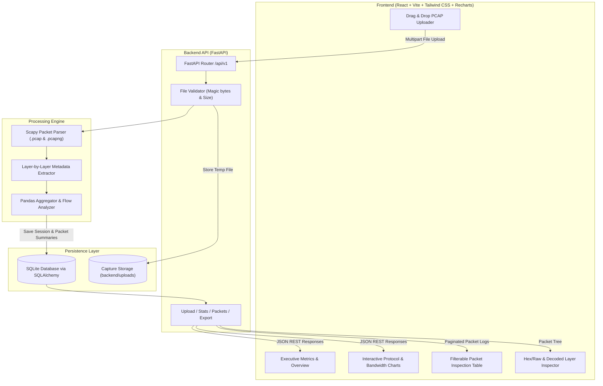
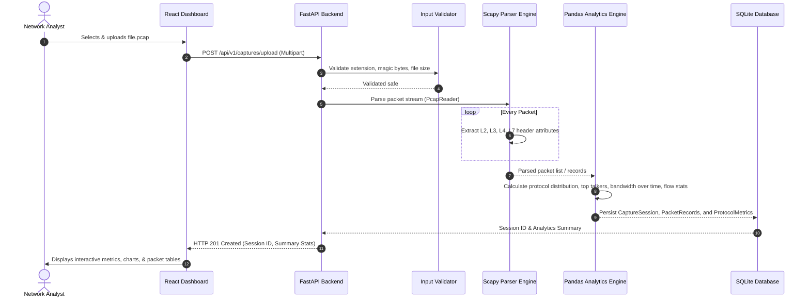

# PacketLens — System Architecture & Design Specification

## 1. System Overview

**PacketLens** is an end-to-end network traffic analysis platform designed to process, parse, analyze, and visualize packet capture files (`.pcap` and `.pcapng`). Built with an asynchronous Python FastAPI backend, Scapy parsing engine, Pandas analytical processor, SQLite database, and a React + Vite + Tailwind CSS dashboard.

---

## 2. Core Protocol Stack Coverage

PacketLens inspects the standard OSI & TCP/IP network model layers:

| Layer | Protocol | Key Fields Extracted |
| :--- | :--- | :--- |
| **Data Link (L2)** | Ethernet, ARP | Source/Dest MAC, Hardware type, Protocol type, ARP opcode (request/reply) |
| **Network (L3)** | IPv4 | Source/Dest IP, TTL, IP Flags (DF, MF), Fragment Offset, Version, IHL, Total Length |
| **Network (L3)** | IPv6 | Source/Dest IPv6, Next Header, Hop Limit, Traffic Class, Flow Label |
| **Transport (L4)** | TCP | Source/Dest Port, Sequence/Ack Numbers, Flags (SYN, ACK, FIN, RST, PSH, URG), Window Size |
| **Transport (L4)** | UDP | Source/Dest Port, Length, Checksum |
| **Transport (L4)** | ICMP / ICMPv6 | Type, Code, Sequence, Checksum (Echo Request/Reply, Unreachable, Redirect) |
| **Application (L7)** | DNS | Query Name, Query Type (A, AAAA, MX, TXT), Response Code, Answer Records |
| **Application (L7)** | HTTP | Method (GET, POST), Host, URI, Status Code, Content-Type (when unencrypted) |

---

## 3. Data Processing Pipeline

---

## 4. Security & Robustness Considerations

1. **Magic Bytes Validation**: Ensure uploaded files match genuine PCAP (`0xa1b2c3d4`, `0xd4c3b2a1`) or PCAPNG (`0x0a0d0d0a`) magic headers rather than solely trusting file extensions.
2. **Resource Exhaustion Prevention**: Use streaming reader (`scapy.utils.PcapReader`) instead of loading gigabyte-sized files all at once into RAM with `rdpcap`.
3. **Strict Path Traversal Protection**: Store uploaded captures using sanitized UUID filenames inside isolated storage (`backend/uploads/`).
4. **Offline Only Safe Parsing**: No live promiscuous mode socket creation required during analysis mode, allowing testing in any standard user environment without root/admin driver dependencies.
